# The night: what runs when

Everything heavy on Nova runs in one window after midnight, **in order, not in parallel**. The backup doesn't start its follow-up jobs on a clock: it starts them when it finishes, so a long night just runs longer instead of colliding with the next job. Times are Europe/Warsaw.

## A normal night

```mermaid
gantt
    title Nova, a normal night
    dateFormat HH:mm
    axisFormat %H:%M
    tickInterval 30minute

    section Weekly
    fstrim (Monday)                  : 00:15, 5m

    section Immich
    Nightly tasks                    : 00:30, 20m
    Database dump                    : 00:50, 2m

    section Backup chain
    Backup (restic + B2 sync)        : bk, 01:00, 20m
    Verify (canary from B2)          : after bk, 2m
    Prune old images                 : after bk, 5m

    section Disks
    SMART short tests                : 02:00, 5m
    SMART long tests (1st Sunday)    : 03:00, 180m

    section Maintenance
    Device maintenance, alerts muted (Sunday) : done, 01:55, 55m
```

## In detail

| When | What | Started by | Usually takes |
|:--|:--|:--|:--|
| Monday 00:15 | `fstrim` (SSD housekeeping) | systemd timer | seconds |
| 00:30 | Immich nightly tasks: memories, face clustering, cleanup | Immich settings | minutes |
| 00:50 | Immich database dump (`.sql.gz`, last 3 kept) | Immich settings | seconds |
| **01:00** | **Backup**: stop Home Assistant, Vaultwarden, Zigbee2MQTT and Authelia's database → restic snapshot → start them again → integrity check (1/7 of the data each night) → sync to Backblaze B2 → prune old snapshots | systemd timer | ~20 min; hours after a big photo import (limit 6 h) |
| after the backup | **Verify**: read the canary file back from B2 | the backup, if it succeeded | seconds |
| after the backup | **Prune** unused container images | the backup, either way | minutes |
| 02:00 | SMART short self-test, every disk | `smartd` | ~2 min |
| 1st Sunday 03:00 | SMART long self-test: backup HDD and NVMe | `smartd` | hours, idle priority |
| 06:00 | Pending-updates check | systemd timer | seconds |
| all day | Certificate check (every 6 h), device-backup check (hourly), package metadata refresh | timers | seconds |
| Sunday 01:55–02:50 | Maintenance window: network devices may restart; their alerts are muted (`weekly-maintenance` in `contact-points.yml.j2`) | Grafana mute timing | - |

Other network devices restart themselves on their own schedules, outside the backup window.

## Rules that follow from it

* **No deploys or reboots while the backup runs.** The Nova playbooks check this themselves (`backup_guard` role) and stop before touching anything; `-e backup_guard_override=true` overrides. In practice: nothing between 00:15 and 02:00.
* **OS updates and reboots in the daytime**, when someone can watch them.
* **A failed backup doesn't skip the prune**, and a failed sync skips the verify (there's nothing new to verify). Missing nights show up as alerts (backup age, canary age).
